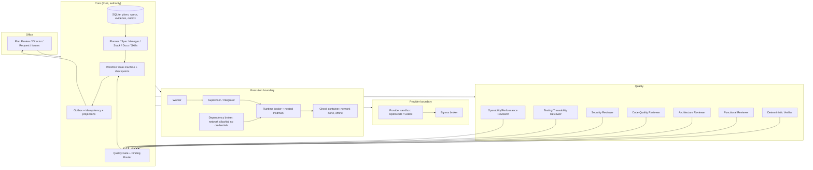
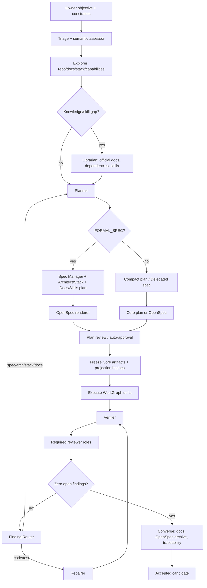
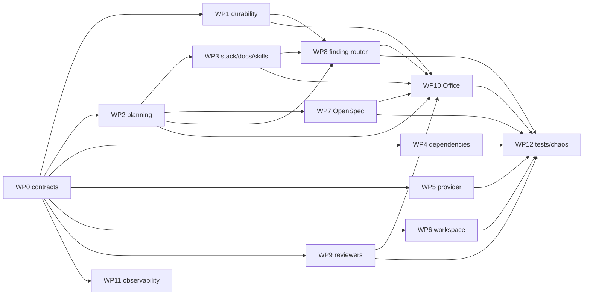

# Quality-first delivery plan — parallel work packages

**Status:** Proposed — 2026-11-09. This is the execution plan for
[ADR-0039](../architecture/decisions/ADR-0039-quality-first-planning-and-stack-selection.md),
the [quality-first planning plan](quality-first-planning-plan.md) and the
[agentic reliability plan](agentic-reliability-plan.md).

No code is implemented by this document. It defines work packages, contracts,
parallel waves, file ownership, acceptance and merge order so several agents can
work without collapsing into merge conflicts.

## 1. Target architecture



Key boundaries:

- **Core** owns authority, plans, hashes, budgets, leases, candidates and Gate.
- **Provider sandbox** makes model calls through the egress broker. It is not
  the check sandbox.
- **Check container** has no network and runs Cargo/Node/Python checks against
  a frozen vendor/cache.
- **Dependency broker** is a separate, network-enabled, credential-free,
  allowlisted step that produces a vendor/cache; it does not run untrusted
  project code with credentials.
- **Reviewers** are separate read-only processes/identities per role.
- **OpenSpec/GitHub** are projections written through the outbox, never
  authority.

## 2. Final flow



## 3. `--offline` and model access

`cargo --offline` does **not** remove model access. It applies only to Cargo's
registry/git access inside the **check container**.

- Model calls are made by the Worker/provider sandbox through the egress broker
  and Core's provider route. Cargo is not involved.
- The check container runs with `--network=none` and `--offline`; it only builds
  and tests source against a frozen vendor/cache.
- Dependency acquisition is a separate, network-enabled, credential-free,
  allowlisted step. It writes `Cargo.lock`/`vendor` atomically; then checks run
  offline again.
- Planning/assessment/reviewer model calls happen in Core/provider sessions,
  not in the check container.
- If the model were executed inside the check container, `--offline`/no-network
  would block it. The architecture deliberately separates inference from
  untrusted repository execution.

So: **offline checks + online inference + brokered dependency acquisition** can
coexist. They are different boundaries.

## 4. Work packages

| WP | Name | Owner agent | Depends | Main files | Deliverable |
|---|---|---|---|---|---|
| WP0 | Contracts, schemas, interfaces, migration skeleton | Integration/Core | — | `native/src/planning/contracts.rs` (new), `native/src/model_output.rs`, `migrations/`, `office/src/coreApi.ts` types | Frozen JSON/Rust contracts, DB schema, API types, module stubs |
| WP1 | Durable workflow, checkpoints, outbox, idempotency | Core durability | WP0 | `native/src/workflow.rs` (new), `native/src/db/workflow.rs` (new), migrations | State machine, recovery, outbox, idempotency |
| WP2 | Planning route, prompts, Planner/Spec Manager lifecycle | Planning | WP0 | `native/src/planning/route.rs` (new), `native/src/planning/prompts.rs` (new), `native/src/bin/core.rs` handlers | Route floors, Planner all, Spec Manager FormalSpec, plan review |
| WP3 | Stack, architecture, docs, skills, Librarian | Planning/knowledge | WP0, WP2 | `native/src/planning/stack.rs`, `architecture.rs`, `docs.rs`, `skills.rs` (new), `native/src/knowledge.rs` | Stack/ADR, architecture, docs plan, skill packs |
| WP4 | Dependency supply chain | Execution/supply chain | WP0 | `native/src/dependencies.rs` (new), `native/src/execution.rs`, `native/src/bin/runtime_broker.rs`, tooling | Vendor/cache, brokered fetch, SBOM/license/audit |
| WP5 | Provider/stream/structured-output reliability | Provider | WP0 | `native/src/bin/worker.rs`, `provider_bridge.rs`, `egress_bridge.rs`, `native/src/runtime.rs` | SSE cursor/reconnect, long turns, schema repair, reservations |
| WP6 | Workspace/execution reliability | Execution | WP0 | `native/src/execution.rs`, `workspace_archive.rs`, `bin/supervisor.rs`, `bin/runtime_broker.rs` | Content-addressed snapshots, hashes, cleanup, target tmpfs |
| WP7 | OpenSpec renderer/validator/archive | OpenSpec | WP0, WP2 | `native/src/openspec.rs` (new), `deploy/` OpenSpec image, docs | Deterministic change folders, validate, archive |
| WP8 | Finding Router, auto-repair/replan | Quality/orchestration | WP1, WP2, WP3 | `native/src/planning/findings.rs` (new), `native/src/db/quality.rs`, `bin/core.rs` handlers | Findings block, route, repair/replan, budgets |
| WP9 | Reviewer fleet, roles, Gate | Review | WP0 | `native/src/bin/reviewer.rs`, `semantic_review.rs`, `db/quality.rs`, `compose.yaml` | Separate reviewer processes/identities, role prompts, zero-finding Gate |
| WP10 | Office Plan Review/Director/Request/Issues | Office | WP2, WP3, WP7, WP8, WP9 | `office/src/views/*`, `office/src/coreApi.ts`, tests | Plan review UI, stack/arch/docs/skills/traceability, reviewer status |
| WP11 | Observability, trace, replay | Observability | WP1 | `native/src/telemetry/*`, `native/src/db/events.rs`, UI | Event log, trace, replay, alerts |
| WP12 | Tests, chaos, evals, browser acceptance | QA | WP0, then parallel | `native/tests/*`, `office/e2e-browser/*`, fixtures | Fault-injection suite, golden E2E, per-option UI |

## 5. Parallel waves



**Wave 0 — sequential, one integration agent or two coordinated agents:**
WP0 only. Freeze Rust/JSON schemas, DB tables, API types, module stubs and
contract tests. No feature work until this is merged.

**Wave 1 — parallel (6–8 agents possible):**
WP1, WP2, WP4, WP5, WP6, WP9, WP11. Each works against WP0 contracts and
new modules. WP3/WP7/WP8 wait for WP2 interfaces.

**Wave 2 — parallel:**
WP3, WP7, WP8, WP10 (Office against mocked/contract APIs), WP12 test scaffolding.
WP10 can start once WP2/WP3/WP7/WP8/WP9 API types are frozen; it should not wait
for backend completion.

**Wave 3 — integration and acceptance:**
WP10 live wiring, WP12 full E2E/chaos, cross-workstream contract tests, final
candidate evidence.

## 6. Shared-file and merge rules

Parallel agents must not edit shared files directly:

- `native/src/bin/core.rs` — only the **Core integration owner** wires routes
  and handler registrations. Work packages add functions in their own modules;
  the integration owner applies the small registration diff.
- `native/src/db/mod.rs` — one integration owner; work packages export their
  module and provide the registration line.
- `migrations/` — one migration owner per wave. Work packages submit SQL
  fragments/requirements; the migration owner assigns numbers and merges.
- `office/src/coreApi.ts` — one Office integration owner; WP10 owns UI files,
  backend WPs provide exact TypeScript types.
- `Cargo.toml` / `compose.yaml` — one build/infra owner; work packages request
  dependencies/services.
- `docs/README.md`, ADR index — one docs owner.

Each work package:

1. Works in its own worktree/branch (`factory/planning-wpN-*`).
2. Adds new files where possible.
3. Publishes a contract/interface note if it needs a shared-file change.
4. Runs its unit/contract tests and `cargo fmt`/Clippy or Office typecheck/lint.
5. Reports changed files, interfaces, tests, and remaining integration work.

Merge order: WP0 → (WP1, WP2, WP4, WP5, WP6, WP9, WP11) → (WP3, WP7, WP8) →
WP10 → WP12. The integration owner resolves shared-file registrations in one
small commit per wave.

## 7. Agent assignment template

Give each agent a prompt like:

```text
You own WPn: <name>.
Read ADR-0039, docs/implementation/quality-first-planning-plan.md,
docs/implementation/agentic-reliability-plan.md and
docs/implementation/quality-first-delivery-plan.md.
Implement only WPn. Do not edit shared files listed in section 6.
New code goes in <files>. Expose the interfaces in WP0 contracts.
Acceptance: <WP acceptance>. Run <commands>.
If an interface change is required, write a contract-change note and stop;
do not modify another work package.
Report: changed files, interfaces, tests, migrations, remaining integration.
```

## 8. Acceptance per work package

| WP | Acceptance |
|---|---|
| WP0 | Schemas/types compile; invalid artifacts rejected; DB migration applies; contract tests; no behavior claim |
| WP1 | Kill/restart at every state resumes; duplicate idempotency key no duplicate effect; outbox replay safe |
| WP2 | Greenfield/large routes FormalSpec; Direct always has plan; Lead no plan; Planner all; Spec Manager FormalSpec |
| WP3 | Stack precedence/points; owner escalation only above budget/reserved; docs/skill plan; stale skill blocks FormalSpec |
| WP4 | Rust vendor/cache offline build/test; cargo-deny/audit/SBOM; brokered fetch atomic; dependency blocker explicit |
| WP5 | SSE cut/reconnect; long turn; malformed JSON repair; no partial candidate; no orphan session |
| WP6 | Content-addressed snapshot; generated artifacts excluded; corrupt snapshot rejected; cleanup/orphan reconciliation |
| WP7 | OpenSpec folder deterministic; validate; archive idempotent; drift detected; Core authority |
| WP8 | Every finding blocks; router; automatic repair/replan; budget exhaustion owner decision; no silent accept |
| WP9 | Separate reviewer identities/processes; required roles; zero-finding Gate; no self-review; identity-based independence with model diversity only a non-blocking observation |
| WP10 | Plan review all lanes; auto-approval; stack/arch/docs/skills/traceability; reviewer/finding states; responsive/a11y |
| WP11 | Trace per step; event log; replay; alerts; no secrets |
| WP12 | Chaos matrix; golden E2E; per-option browser; flaky-free repeat runs |

## 9. Remaining doubts / owner decisions

1. **Info findings:** you said all findings block. Should `info` also block
   acceptance, or can it be closed by an evidenced explanation without a code
   change? Recommended: `info` must be closed/resolved or explicitly refuted,
   but it does not require a code change; no silent acceptance.
2. **Durable workflow implementation:** hand-rolled SQLx state machine vs a Rust
   durable-execution/job crate. Recommended: hand-rolled Core state machine with
   SQLx first; evaluate a crate only for scheduling, never authority.
3. **OpenSpec toolchain:** official Node/OpenSpec image vs a Rust subset. Recommended:
   pinned Node 22.12 + OpenSpec CLI image/cache, because `openspec validate` is
   the real contract; no host dependency.
4. **Reviewer fleet cost:** separate processes/identities per role means 5–6
   reviewer services/tokens and more model calls. Confirm you accept that cost.
5. **Reviewer model routes:** current profile has one semantic reviewer route.
   Do you want different models per role (architecture/security stronger) or
   same model with different prompts? Recommended: different routes for
   Architecture/Security on `ELEVATED`/`CRITICAL`.
6. **Dependency broker placement:** ephemeral network-enabled container with
   allowlist and no credentials vs Core-mediated fetch. Recommended: separate
   ephemeral broker; owner approves egress policy.
7. **Auto-approval threshold:** exact points/risk budget for plan auto-approval
   and stack changes. Recommended: R0 within budget auto; R1 bounded; R2/R3
   owner; stack change above budget owner.
8. **Documentation minimum:** tiered baseline recommended. Do you want it
   mandatory for every project, or tiered by CLI/service/UI/library? Recommended:
   tiered, but required docs for the tier block acceptance.
9. **OpenSpec for Direct:** recommended compact Core plan + optional OpenSpec;
   FormalSpec mandatory. Confirm.
10. **Historical plans:** keep old Lead plans read-only as provenance and
    re-render active requests through the new pipeline, or migrate everything?
    Recommended: read-only history, new pipeline for active/new requests.
11. **Parallel agent count:** how many agents/worktrees do you want? Wave 1 can
    support 6–8; more increases integration overhead. Recommended: 4–6
    concurrent work packages plus one integration owner.
12. **Timeline:** 5–6 weeks for the full plan; a P0 reliability subset (WP0,
    WP1, WP5, WP6, WP9, WP12) can be a first milestone in ~2–3 weeks.

## 10. Recommended first milestone

Before the next paid live campaign, deliver:

- WP0 contracts;
- WP1 durable workflow/idempotency/outbox;
- WP5 provider reliability;
- WP6 workspace reliability;
- WP9 reviewer identities/zero-finding Gate;
- WP12 deterministic tests/chaos for those paths.

Then add WP2/WP3/WP4/WP7/WP8/WP10/WP11 for the full quality-first flow.

## 11. Definition of done for the program

A request is accepted only when:

- the frozen plan/spec/OpenSpec (or compact Direct plan) exists;
- stack/architecture/docs/skills decisions are recorded;
- every required check and reviewer role has executed evidence;
- zero findings remain open;
- docs/OpenSpec/traceability are current;
- the candidate is exact and the Gate is deterministic;
- the workflow can be replayed/recovered without duplicate effects;
- no host-only dependency, secret leak, or model-granted authority exists.

## 12. References

- [ADR-0039](../architecture/decisions/ADR-0039-quality-first-planning-and-stack-selection.md)
- [Quality-first planning plan](quality-first-planning-plan.md)
- [Agentic reliability plan](agentic-reliability-plan.md)
- [OpenSpec](https://openspec.dev/) and [quickstart](https://openspec.dev/docs/quickstart)
- [Cargo vendor](https://doc.rust-lang.org/cargo/commands/cargo-vendor.html)
- [Rust Supply Chain Security Guide](https://rust-secure-code.github.io/rust-supply-chain-security/)
- [C4/arc42/ADR documentation](https://www.highcircl.com/en/blog/software-architecture-documentation)
- [Diátaxis](https://diataxis.fr/)
