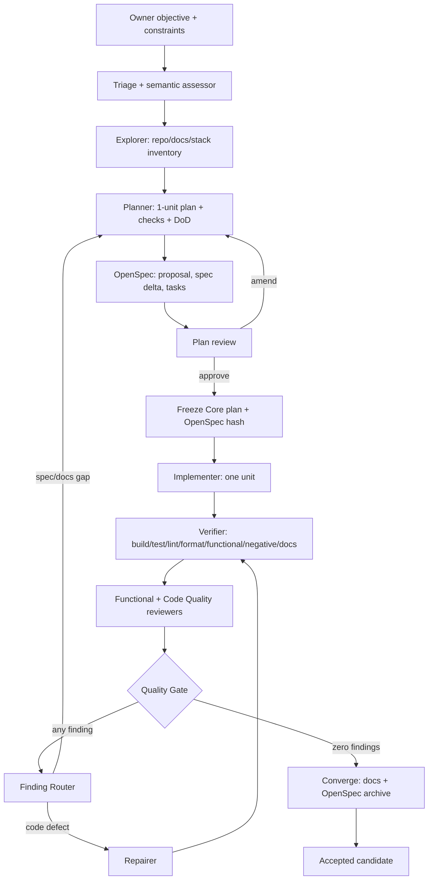
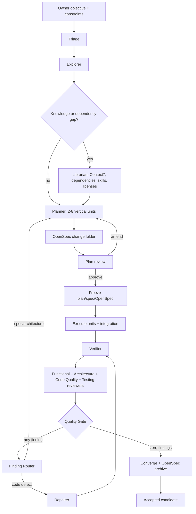
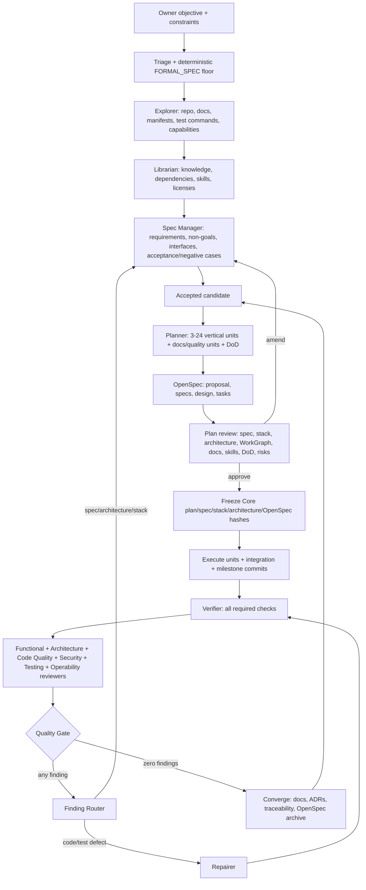
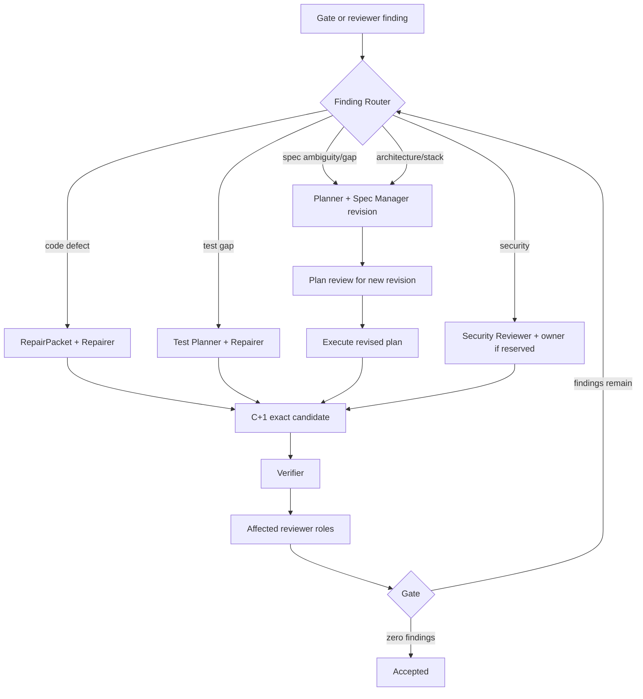
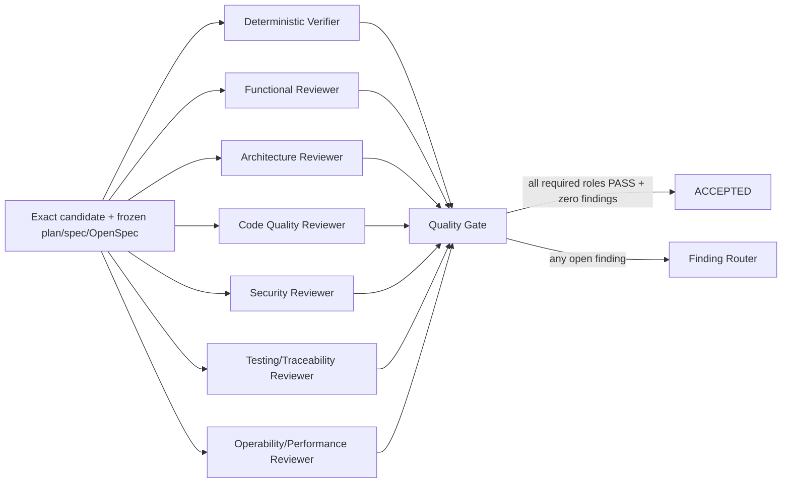
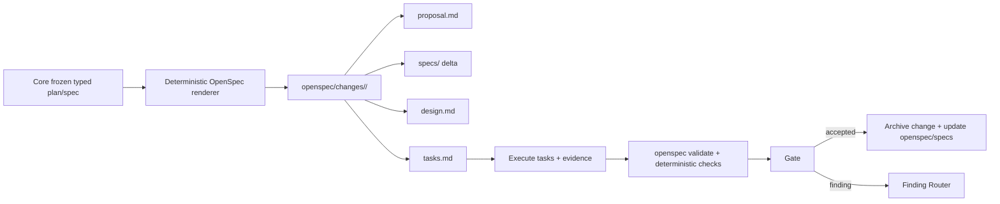

# Quality-first planning and stack-selection implementation plan

**Status:** Proposed — 2026-11-09. Design authority:
[ADR-0039](../architecture/decisions/ADR-0039-quality-first-planning-and-stack-selection.md).
No behavior is claimed until the phases below have candidate-bound evidence.

## Owner decisions

The 2026-11-09 owner decisions are now part of the design:

1. Every reviewer finding blocks acceptance and must be resolved
   automatically; there is no silent warning debt.
2. Changing the stack of an existing repository requires explicit owner
   approval.
3. Dependency acquisition supports both a digest-pinned vendor/cache and a
   brokered fetch; the project plan chooses one or both.
4. Plan review is mandatory for every lane, including `DIRECT`.
5. Documentation is quality-first: the minimum set that actually protects the
   built product, not a fixed file count.
6. The Lead is a thin assessor. The Planner runs in every flow; the Spec
   Manager always runs for `FORMAL_SPEC`.
7. OpenSpec is the repository-facing specification projection for every change;
   Core remains the authority.
8. Reviewers are specialized: functional, architecture, code quality, security,
   testing/traceability and operability/performance where applicable.

## 1. Why this plan exists

The 2026-11-09 gym-manager run proved the Factory can produce an accepted
candidate from a high-level objective, but the plan chose a narrow CLI slice
without a formal stack/architecture/documentation decision. The accepted
candidate is recorded in
[the gym evidence](../evidence/gym-manager-2026-11-09/README.md).

The current structure, not just the prompt, causes this:

| Area | Current behavior | Effect |
|---|---|---|
| Home planning | Uses the Lead proposal path; `native/src/lead_model.rs` forces exactly one implementation unit and the smallest path/capability subset. | A large objective becomes one shallow unit. |
| Rich planning | Planner/Spec Manager exist in `native/src/bin/core.rs` and `native/src/agentic.rs`, but they are Director actions, not the normal lifecycle. | The rich path is optional and usually unused. |
| Route floors | `agentic_triage_context` hardcodes architecture/public-contract/data/security signals to `false`. A greenfield request with a one-unit proposal routes `DIRECT`. | Greenfield/large work does not become `FORMAL_SPEC`. |
| Stack | `StackProfile` detects existing manifests only. The Planner prompt says "Never invent a file, dependency or technology." | The model cannot choose or justify a stack; std-only is the easiest path. |
| Dependencies | Checks run offline with no vendor/cache or brokered fetch. | A planner cannot honestly select a crate/framework that is not already available. |
| Quality | `QualityProfile` is a fixed enum; `Generic` requires only build/test/functional/negative. | No mandatory format, lint, typecheck, docs, ADR, security or traceability checks. |
| Review | One generic reviewer; warnings can be accepted; reviewer lacks the spec/stack/architecture/docs/DoD. | Architecture, code quality and security are under-reviewed; quality debt can be silent. |
| Continuation | No-progress breaker halts; no automatic replan; plan is prompt context. | Work stops halfway instead of diagnosing/replanning. |
| Documentation | Target repos are not required to have `AGENTS.md`, architecture docs or ADRs. | The next agent starts without conventions or decision history. |
| OpenSpec | Not integrated. | No durable, human-readable change folder in the repository. |

## 2. Target lifecycle

Every request follows the same durable lifecycle. The lane changes depth,
reviewer set and approval, not whether planning happens.

```text
Owner objective + constraints
  -> Triage: semantic assessor + deterministic floors
  -> Explorer: repository, docs, stack, test and capability inventory
  -> Librarian: knowledge/dependency/skill gaps (when needed)
  -> Planner: spec-lite/full spec, stack, architecture, WorkGraph, docs, DoD
  -> OpenSpec renderer: proposal.md, specs/, design.md, tasks.md
  -> Plan review (mandatory): owner or charter-authorized approval
  -> Freeze: Core typed plan/spec + OpenSpec hash
  -> Execute WorkGraph units with per-unit DoD
  -> Verifier: deterministic checks
  -> Reviewer roles: functional, architecture, code quality, security, testing
  -> Quality Gate
  -> Finding Router -> automatic repair/replan -> re-verify/re-review
  -> Converge: docs, OpenSpec archive, traceability, delivery projection
```

`DIRECT` uses the same lifecycle with a compact plan and one unit.
`DELEGATED` uses 2–8 units. `FORMAL_SPEC` uses the full spec, architecture,
stack options, docs and reviewer set. `REPAIR` starts from an exact candidate
and a RepairPacket, but still follows plan review when the finding changes the
spec or architecture.

## 3. Flow diagrams

### 3.1 Direct flow



### 3.2 Delegated flow



### 3.3 FormalSpec flow



### 3.4 Repair flow



### 3.5 Reviewer topology



### 3.6 OpenSpec lifecycle



## 4. OpenSpec integration

OpenSpec is the repository-facing plan/spec format, not a second authority.

- Every change gets `openspec/changes/<change-id>/`:
  - `proposal.md`: why, what changes, non-goals.
  - `specs/<capability>/spec.md`: requirements and scenarios (delta).
  - `design.md`: stack, architecture, ADRs, dependencies, tradeoffs.
  - `tasks.md`: WorkGraph tasks with checkboxes, acceptance and evidence.
- `openspec/specs/` is the current accepted behavior; completed changes are
  archived under `openspec/changes/archive/`.
- Core deterministically renders the files from the frozen typed
  plan/spec/stack/architecture/WorkGraph/DoD. The renderer is idempotent and
  revision-bound.
- Owner amendments happen in Office plan review; Core validates and freezes a
  new revision, then re-renders. A direct repository edit is draft context until
  Core validates it; it cannot silently mutate the frozen plan.
- The implementer updates `tasks.md` checkboxes as units complete. Core
  validates the task, checks and evidence; a checkbox alone is not acceptance.
- `openspec validate` (or the pinned OpenSpec CLI) is a deterministic check when
  the toolchain is available. The toolchain is a pinned Node/OpenSpec image or a
  digest-pinned cache; checks remain offline. Add an `openspec-toolchain`
  capability, or use `node-toolchain` with a cached OpenSpec package.
- Core remains authoritative for requirements, paths, checks, budgets, hashes,
  leases, candidates and the Gate. OpenSpec is a projection like the GitHub
  issue board; it never grants authority.

OpenSpec's `explore → propose → review → apply → archive` loop matches the
Factory's `Explorer → Planner/Spec Manager → Plan review → Execute → Converge`
loop. The mapping is deliberate and should stay one-to-one.

## 5. Artifacts

### 5.1 Project constitution (`AGENTS.md`)

A concise project-level contract:

- build, format, lint, typecheck, test, functional, negative, browser/security
  commands that actually work;
- repository structure, module boundaries and error/validation conventions;
- security, secrets, data and migration rules;
- links to architecture, ADRs, product docs, OpenSpec and plans;
- explicit non-goals.

Aim for under ~150 lines. Generate only when absent or materially incomplete;
existing docs are cited and preserved. Documentation is quality-first: include
whatever a new engineer/agent needs to change the system safely, and no
duplicate README/encyclopedia content.

### 5.2 Stack decision

```json
{
  "schemaVersion": 1,
  "source": "USER | EXISTING | MODEL",
  "constraints": ["container-native", "offline checks after vendoring"],
  "options": [
    {
      "id": "rust-std-cli",
      "summary": "std-only Rust CLI with JSON persistence",
      "fit": 3,
      "security": 5,
      "maintainability": 5,
      "operability": 5,
      "timeToValue": 5,
      "exitCost": 2,
      "pros": ["no dependency supply chain", "fits offline checks"],
      "cons": ["limited web/API scope"],
      "evidenceRefs": ["Cargo.toml", "AGENTS.md"]
    }
  ],
  "selected": "rust-std-cli",
  "reason": "Bounded local CLI; std-only meets the quality attributes and capabilities.",
  "confidence": "high",
  "requiredCapabilities": ["generic-toolchain"],
  "dependencyPlan": {"status": "not-required", "items": []},
  "stackChange": false,
  "ownerApproval": null,
  "adrPath": "docs/architecture/decisions/ADR-0001-stack-rust-std-cli.md"
}
```

Precedence: **user constraints > existing project stack/conventions > model
proposal**. A change to an existing stack is a reserved owner decision. Every
selection records rejected options and why. For `FORMAL_SPEC`, at least two
realistic options are normally required; a single option needs a recorded
reason.

### 5.3 Architecture plan

Context, components, responsibilities, boundaries, interfaces, data ownership,
deployment, quality attributes, risks, sensitivity points, tradeoffs and ADR
references. It must comply with service placement and container-native policy.
A container/Pod is never described as certified isolation.

### 5.4 Formal spec

Observable behavior, user journeys, interfaces, constraints, non-goals,
assumptions, acceptance cases and negative cases. Requirements are numbered,
traceable and testable; implementation instructions are rejected. The Spec
Manager schema is extended with non-goals, quality attributes, interfaces and
documentation requirements.

### 5.5 WorkGraph and Definition of Done

Vertical slices, 1–24 units. Each unit has one responsibility, dependencies,
non-overlapping write paths, 2–6 observable acceptance checks, exact commands,
docs impact, handoff and remaining work. `FORMAL_SPEC` needs at least three
units plus a foundation/docs/architecture unit and an independent
verification/quality unit.

Project DoD: build, format, lint, typecheck (where the stack provides them),
tests, functional/negative checks, security/dependency checks, required
`AGENTS.md`/architecture/ADR/OpenSpec updates, traceability, zero open findings.
Unit DoD: its checks pass, docs impact applied, handoff recorded. The Worker
cannot finalize a unit without its DoD; the Gate cannot accept without the
project DoD evidence.

### 5.6 Documentation and skill plans

`DocumentationPlan` lists existing docs, required new docs, owners and
acceptance checks. `SkillPlan` lists needs, existing skills, proposed temporary
skills, license status, scope and adoption decision. A skill never grants
tools, authority or scope.

## 6. Route and plan-depth rules

1. Greenfield (no manifest, no docs, no usable stack) → `FORMAL_SPEC`.
2. Large/ambiguous, architecture uncertainty, public contract, data/schema,
   security boundary, cross-module, >5 files or >1 expected unit →
   `FORMAL_SPEC`.
3. 2–8 units with existing stack/docs and no public contract → `DELEGATED`.
4. Small bounded change with existing stack/docs → `DIRECT`.
5. Every lane produces a plan and passes plan review. `DIRECT` uses a compact
   OpenSpec change; it does not skip planning.
6. `FORMAL_SPEC` with fewer than 3 units or no docs/quality unit → reject and
   replan.
7. Every plan records non-goals and out-of-scope items.

## 7. Stack and dependency selection

Use a lightweight ATAM-style utility tree:

1. Elicit 5–10 architecturally significant requirements.
2. Inventory existing stack/docs and available Factory capabilities.
3. The Librarian researches candidate dependencies, skills and current
   practices (Context7/web) and records provenance, license, maintenance and
   security.
4. Propose 2–3 candidate stacks; state fit and tradeoffs.
5. Reject candidates needing unavailable capabilities, unsupported
   dependencies, host-only runtime or non-compliant licenses.
6. Select the smallest coherent stack satisfying high-priority attributes;
   record ADR, confidence and dependency plan.
7. If the stack changes an existing project, require explicit owner approval.

Dependency acquisition supports both:

- **Vendor/cache:** digest-pinned cache image or vendored directory, offline
  checks, SBOM, license/security evidence.
- **Brokered fetch:** separate network-enabled, credential-free
  process/container with allowlist, lockfile, checksums, retries, license and
  vulnerability checks; result vendored before offline checks.

The Planner chooses per project; the Librarian supplies evidence. If neither is
available, the Planner declares the constraint, chooses a fitting stack or
raises an owner decision. It never pretends a dependency is installed.

## 8. Reviewer roles and the Gate

The ParticipantPlan defines required reviewer roles by lane/assurance:

| Role | Focus | Direct | Delegated | FormalSpec |
|---|---|---|---|---|
| Functional | Behavior vs spec, edge cases, negative cases | required | required | required |
| Architecture | Boundaries, ADRs, stack fit, tradeoffs, coupling | optional | required | required |
| Code Quality | Readability, duplication, errors, naming, maintainability | required | required | required |
| Security | Secrets, authz, dependencies, injection, unsafe paths | if boundary | if boundary | required |
| Testing/Traceability | Requirement→check→test→evidence, coverage gaps | optional | required | required |
| Operability/Performance | Runtime, observability, resource limits, NFRs | optional | optional | when applicable |

Each role is a separate read-only session and principal with a role-specific
prompt and evidence. The Gate requires every required role to return an
executed PASS with zero open findings. The current single reviewer token is a
temporary deployment limitation; the plan must provision multiple reviewer
identities. Same model family is allowed, but critical work should use a
different provider/model where available. No implementer self-review.

The reviewer bundle includes: frozen spec, OpenSpec change, stack decision,
architecture, docs plan, DoD, traceability matrix, diff, source and verifier
evidence. Reviewer prompts must flag spec drift, architecture deviation,
missing docs and unowned findings.

## 9. Finding Router and automatic resolution

Every finding blocks acceptance. The deterministic router maps:

| Finding | Route |
|---|---|
| Code defect, error handling, performance bug | Repairer + exact candidate C+1 |
| Missing/weak test, traceability gap | Test Planner/Repairer + new checks |
| Spec ambiguity, missing behavior, non-goal conflict | Planner + Spec Manager revision |
| Architecture/stack deviation | Planner/Architect + owner if stack change |
| Security issue | Security Reviewer + owner if reserved |
| Documentation/ADR gap | Documentation unit/Planner |
| Provider/infrastructure failure | retry/recover, not a code finding |

The campaign loops: repair/replan → new candidate/revision → verifier →
required reviewers → Gate. The loop is bounded by the frozen policy. If the
budget is exhausted, the campaign goes to an owner decision, never to silent
acceptance. Findings, dispositions, evidence and the resolving revision are
durable records.

## 10. Durability, reliability and flakiness

The planning/execution lifecycle is a durable state machine, not an ad-hoc
loop.

- Persist every transition/checkpoint; resume after crash, redeploy or
  compaction from the last durable state.
- Idempotency keys for starts, repairs, provider turns, GitHub/OpenSpec
  projections and external effects. Reconcile before retry; reject duplicate
  dispatch.
- Event cursor/replay for provider streams; reconnect SSE; no partial candidate
  on a provider error.
- Content-addressed workspace snapshots; exclude generated artifacts; verify
  tree hashes; clean volumes; no cross-attempt reuse.
- Pin images/toolchains by digest; deterministic test environment (timezone,
  locale, seed, no network); retries only for infrastructure, never to turn a
  failing assertion green.
- Dependency fetch: lockfile, checksums, cache, SBOM, license/security checks,
  retry/backoff, no partial vendor.
- GitHub/OpenSpec projections: outbox, idempotency, rate-limit handling,
  drift detection, reconciliation; no duplicate issues/PRs.
- Lease/fencing: heartbeat, cancellation races, idempotent operations,
  exactly-once external effects.
- Context: durable plan/OpenSpec/tasks, unit checkpoints, handoff probes;
  compaction never replaces evidence.
- No-progress: bounded diagnosis/replan, not an immediate campaign halt;
  escalate to owner when replans are exhausted.
- Observability: trace/span per step, event log, evidence, replay; redact
  secrets/prompts.

Known flaky areas to test explicitly: provider SSE/stream cut, long model
turns, malformed structured output, workspace archive size, noexec tmpfs,
dependency fetch, GitHub rate limits, nested Podman image import, DNS/network,
lease expiry, context compaction, stale UI polling, cancellation races, test
ordering/random ports/timezones, and model/provider differences.

## 11. Office experience

- Home: optional planning constraints (language/framework/deploy target,
  dependencies, non-goals) and Auto/Formal planning. Auto is default; the
  deterministic floor wins.
- Plan review for every lane: Spec/OpenSpec, Stack, Architecture, WorkGraph,
  Docs, Skills, Checks/DoD, Risks, Traceability. Approve/amend/reject; Core
  freezes the exact revision. R0 may auto-approve under an explicit charter,
  but the plan is shown and frozen.
- Director: stack decision, ADRs, architecture, docs coverage, skill plan,
  reviewer plan and traceability.
- Request workspace: truthful `Planning` / `Awaiting plan review` stages; show
  open findings, automatic repair/replan state and reviewer roles.
- Issues/kanban: OpenSpec/spec issue projection; accepted changes archive the
  OpenSpec change; no decorative actions.

## 12. Data, API and migration

New immutable, revisioned artifacts bound to request/plan/spec:

- `project_constitutions`
- `stack_decisions`
- `architecture_plans`
- `documentation_plans`
- `skill_plans`
- `definition_of_done`
- `plan_reviews`
- `reviewer_plans`
- `finding_dispositions`
- `dependency_plans` and acquisition evidence
- `openspec_projections` (change id, revision, artifact hashes)

Add Core endpoints for discovery, stack, architecture, docs, skills, plan
review, OpenSpec render/validate, finding routing and convergence. Additive
migration; old `LeadPlanProposal`/`FrozenSpec` records remain readable.
`FORMAL_SPEC` requires the new artifacts; `DIRECT` uses a compact subset.

## 13. Phases

| Phase | Scope | Acceptance |
|---|---|---|
| 0 | ADR-0039, contract updates, OpenSpec decision, reviewer topology | Docs reviewed; no behavior claim |
| 1 | Typed artifacts, schemas, validators, DB migration, OpenSpec renderer/validator | Invalid artifacts rejected; hashes immutable; OpenSpec round-trip |
| 2 | Route floors, Planner in every flow, Spec Manager in FormalSpec, plan review all lanes | Greenfield/large never collapses to one unit; Direct still has a plan |
| 3 | Stack/architecture/ADR, Librarian, dependencies (vendor + brokered), OpenSpec toolchain | Stack precedence, owner approval, dependency blockers, offline checks |
| 4 | Durable state machine, finding router, auto-repair/replan, multi-unit execution, context handoff | Crash/resume; findings auto-resolved or owner escalation; no partial candidate |
| 5 | Reviewer roles, Gate, docs/DoD, Office plan review, traceability, OpenSpec archive | All required roles; zero open findings; per-option browser acceptance |
| 6 | Evals and live pilot | 3 live scenarios; first-pass acceptance, docs/OpenSpec/traceability evidence |

Suggested effort: 5–6 weeks, depending on dependency acquisition, reviewer
fleet provisioning and OpenSpec toolchain packaging.

## 14. Test matrix

| Scenario | Expected route | Required evidence | Negative assertion |
|---|---|---|---|
| Greenfield Rust CLI, no docs | `FORMAL_SPEC` | Constitution, 2–3 stack options, ADR, 3+ units, docs/quality units, OpenSpec, DoD | Cannot accept a one-unit plan or missing `AGENTS.md` |
| Greenfield HTTP service needing a framework | `FORMAL_SPEC` | Stack decision, dependency plan, architecture, interfaces, security/health checks | Cannot silently choose an unavailable dependency |
| Existing Rust service, small change | `DIRECT` | Plan review, existing stack/conventions, checks, docs impact, OpenSpec | Cannot skip planning or rewrite stack without owner |
| Existing Node/TypeScript UI | `DELEGATED`/`FORMAL_SPEC` | Typecheck/lint/test/browser, docs, OpenSpec | Cannot skip browser acceptance |
| User specifies stack | selected `source=USER` | Exact constraints, checks, docs, ADR | Model cannot replace it |
| Missing docs in existing repo | `DELEGATED`/`FORMAL_SPEC` | Docs unit, constitution, architecture, OpenSpec | Cannot accept with missing required docs |
| Large objective with one-unit proposal | `FORMAL_SPEC` | Depth rejection, replan, 3+ units | Cannot lower the floor |
| Reviewer warning only | all lanes | Finding Router, repair/replan, re-review | Cannot accept or silently waive |
| Architecture finding | FormalSpec | Planner revision, plan review, re-execute | Cannot patch around a bad architecture |
| Stagnant unit | all | Bounded replan, new graph revision | Cannot stop on first stagnation |
| Crash/restart during planning/execution | all | Durable checkpoint, idempotent resume | No duplicate dispatch/issue/candidate |
| OpenSpec drift | all | Renderer/revision hash, `openspec validate` | Cannot trust edited markdown over Core |

## 15. Metrics

Telemetry, not productivity caps:

- plan completeness rubric (goals/non-goals, stack options, architecture,
  docs, DoD, checks, risks);
- first-pass Gate acceptance rate;
- finding count and automatic resolution rate;
- repair/replan cycles per accepted candidate;
- documentation/OpenSpec coverage and spec-to-code traceability;
- owner approvals/amendments and escalations;
- dependency/security blockers;
- time to first accepted candidate (observability only).

## 16. Risks, non-goals and open decisions

**Risks:** over-planning small changes (compact Direct plan, but still review);
model output unreliable (deterministic validation + role reviewers); dependency
supply chain (allowlist, SBOM, license/security); docs drift (OpenSpec
convergence + checks); reviewer cost/latency (right-size roles by lane);
multiple reviewer identities (provisioning); auto-repair loops (bounded policy,
owner escalation); OpenSpec CLI availability (pinned image/cache).

**Non-goals:** no second orchestrator; no model authority; no automatic public
contract/security/production changes; no stack rewrite without owner decision;
no container-as-isolation claim; no acceptance with open findings.

**Open owner decisions:**

1. Reviewer role minimum per lane/assurance, and whether critical work requires
   a different provider/model.
2. Auto-repair/replan budget and the exact owner-escalation threshold.
3. OpenSpec toolchain packaging: pinned Node image, cached npm package, or a
   Rust renderer/validator subset.
4. Plan review for R0: owner click vs charter-authorized auto-approval after
   deterministic validation.
5. Documentation minimum by project type (CLI, service, UI) under the
   quality-first rule.
6. Migration of historical plans: keep the old Lead plan as `DIRECT` only or
   re-render all active requests through OpenSpec.
7. Reviewer fleet: separate processes/identities per role vs one reviewer
   service with multiple role-scoped principals.

## References

- OpenSpec — spec framework and workflow:
  https://openspec.dev/ and https://github.com/Fission-AI/OpenSpec
- OpenSpec quickstart (explore → propose → review → apply → archive):
  https://openspec.dev/docs/quickstart
- GitHub Spec Kit — Specify → Plan → Tasks → Implement → Converge:
  https://github.github.com/spec-kit/
- Microsoft, Spec-Driven Development:
  https://developer.microsoft.com/blog/spec-driven-development-ai-native-engineering/
- Martin Fowler, Architecture Decision Record:
  https://www.martinfowler.com/bliki/ArchitectureDecisionRecord.html
- Microsoft Azure Well-Architected, ADR:
  https://learn.microsoft.com/en-us/azure/well-architected/architect-role/architecture-decision-record
- AWS, ADR best practices:
  https://aws.amazon.com/blogs/architecture/master-architecture-decision-records-adrs-best-practices-for-effective-decision-making/
- SEI, Architecture Tradeoff Analysis Method:
  https://www.sei.cmu.edu/library/architecture-tradeoff-analysis-method-collection/
- Martin Fowler, Context Engineering for Coding Agents:
  https://martinfowler.com/articles/exploring-gen-ai/context-engineering-coding-agents.html
- Red Hat, AGENTS.md and Agent Skills:
  https://developers.redhat.com/articles/2026/07/27/standardize-project-context-agentsmd-and-agent-skills
- Durable execution for LLM agents:
  https://vadim.blog/durable-execution-llm-agents
- Agentic workflows in production:
  https://www.coreweave.com/blog/agentic-workflows-in-production-mechanisms-trade-offs-costs-and-design-patterns
- Softwarefabrik, plan before you build:
  https://softwarefabrik.io/en/academy/kapitel-05-planen.html
- Deep Work Plan, the plan as source of truth:
  https://www.dailybot.com/blog/how-we-run-long-horizon-agent-work/
- Specifying done:
  https://dsplce.co/agentic-engineering/core/specifying-done
